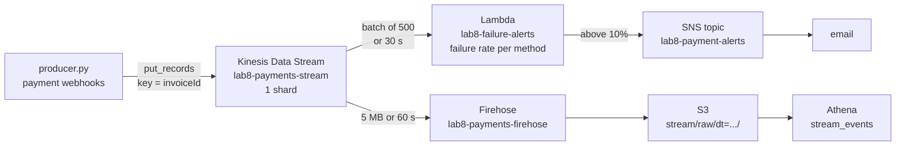

# Lab 8 — Batch and streaming: payments on AWS and on a laptop

Alina Yatsko · 2026-11-06 · account 896138901201 · us-east-1

Everything below was measured, not estimated. Every query id, byte count and run time comes
from an actual run; the files under [`results/`](results/) are the raw output.

| Part | What it asked for | Where |
|---|---|---|
| 1 | Three questions about Uklon's architecture | [part1-uklon.md](part1-uklon.md) |
| 2 | Scale, queries 2–6, JSON vs Parquet, the DISTINCT question | [§2](#part-2--batch-payments-in-s3) |
| 3 | Redpanda, producer, consumer, four experiments | [§3](#part-3--streaming-on-a-laptop) |
| 4 | Diagram, producer, Athena over streamed data, cost | [§4](#part-4--the-same-thing-in-the-cloud) |

One thing is left for a human: **the screenshot of the Athena query** (Part 4). The query and
its result are below; the console screenshot needs a browser.

---

## Part 2 — Batch: payments in S3

The dataset was copied into `s3://ucu-lab8-payments-896138901201/payments/` — 31 objects,
1.26 GB. The first attempt failed on every object:

```
An error occurred (AccessDenied) when calling the GetObjectTagging operation
```

The public bucket grants `s3:GetObject` but not `s3:GetObjectTagging`, and the CLI copies tags
by default. `aws s3 cp --copy-props none` skips them and the copy goes through.

### The answers about scale

| | |
|---|---|
| Events | 3 030 197 |
| Unique `invoiceId` | 1 000 000 |
| Exact duplicates | **30 197 (1.00%)** |
| Events later than 60 s | 60 824 (2.007%) |
| Events later than **an hour** | **0** |
| Worst delay | 600 s exactly; p99 326 s; mean 7.63 s |

The share later than an hour is zero, and that is a fact about the generator rather than luck:
the worst delay in three million events is exactly 600 seconds, so lateness is bounded at the
ten minutes the brief promises. A consumer that waits two minutes for stragglers is therefore
making a deliberate trade, not covering every case — see experiment 4.

The duplicates are worth one extra line. Counting repeats of the whole row and repeats of just
`(invoiceId, status, modifiedDate)` gives the same number, 30 197, so every duplicate is
byte-identical, `receivedAt` included. That is what makes `SELECT DISTINCT` sufficient; had the
repeats differed in arrival time, DISTINCT would have kept both and the deduplication would
have needed the three-column key.

### Why DISTINCT comes before `row_number()`, and what breaks without it

They solve different problems and neither covers the other.

`DISTINCT` answers *"is this the same event?"*. `row_number()` answers *"which event of this
payment is the latest?"*. Run alone, `row_number()` looks like it also removes duplicates — it
keeps one row per payment, after all — but that is an accident of this particular query. A
duplicate is a separate row carrying the same `modifiedDate`, so the two tie in the window's
ORDER BY and the engine keeps whichever it likes. The payment-level result is right by luck.

What breaks is everything that counts rows instead of picking one:

- any `SUM` over events — turnover computed from the event stream rather than from the view
  would be about 1% high, which on this month is roughly 6 million hryvnia of revenue that
  does not exist;
- `count(*)` of events per status, per merchant, per hour — all 1% high;
- the failure rate, whose numerator and denominator are both inflated but not equally, because
  duplicates are not spread evenly across statuses.

Without any deduplication at all the damage is larger and quieter: 3 030 197 events for
1 000 000 payments means a naive `count(*)` reports three times too many "payments", and a
`GROUP BY invoiceId` with `max(status)` picks alphabetically — `success` sorts after
`processing` but before nothing useful — rather than by time.

### The results of queries 2–6

Full output in [`results/`](results/). Query 2 is the view itself: 1 000 000 rows, exactly one
per `invoiceId`.

**3. Turnover by merchant and currency** ([`04-turnover-json.txt`](results/04-turnover-json.txt)) —
10 merchants × 3 currencies. The UAH column, which is where the volume is:

| Merchant | Payments (UAH) | Turnover (UAH) | Average |
|---|---|---|---|
| Інтернет-магазин | 87 115 | 310 259 259.21 | 3 561.49 |
| АЗС | 87 560 | 144 641 341.06 | 1 651.91 |
| Квитки | 87 303 | 77 749 863.65 | 890.57 |
| Супермаркет | 87 283 | 54 147 597.02 | 620.37 |
| Доставка їжі | 87 820 | 46 044 018.26 | 524.30 |
| Аптека | 87 374 | 38 554 151.04 | 441.25 |
| Таксі | 87 307 | 21 528 219.39 | 246.58 |
| Онлайн-кінотеатр | 87 357 | 13 016 193.00 | 149.00 |
| Кав'ярня | 87 637 | 11 435 687.68 | 130.49 |
| Музичний сервіс | 87 517 | 8 664 183.00 | 99.00 |

Two of them — the cinema and the music service — have an average exactly equal to 149.00 and
99.00 with no variance at all. They are subscriptions, and the data says so without being asked.

**4. Failure rate by method and device** ([`05-failure-rate-json.txt`](results/05-failure-rate-json.txt)):

| Method | Device | Payments | Failed | Rate |
|---|---|---|---|---|
| qr | android | 6 675 | 448 | **6.71%** |
| apple_pay | android | 83 677 | 5 130 | 6.13% |
| google_pay | web | 59 996 | 3 645 | 6.08% |
| … | | | | |
| qr | ios | 6 795 | 402 | 5.92% |

The spread is 5.92% to 6.71% across twelve combinations, which is to say there is no signal
here: the generator applies one failure probability to everything and the differences are
sampling noise. The honest reading of this table is "no payment method is worse than another",
and noticing that is the point — a 0.8-point gap on 6 675 payments is not a finding.

Every payment reached a terminal status: the in-flight share is 0.00% in all twelve rows.

**5. Payments per hour** ([`06-peak-hours-json.txt`](results/06-peak-hours-json.txt)): two peaks,
a small one at 12:00 (66 304) and the real one at 18:00 (80 338), with the trough at 02:00–04:00
(about 6 600 per hour). Evening is twelve times quieter than night at its extreme, and the shape
is the ordinary one for consumer payments — lunch and after work.

**6. Late events** ([`07-late-events-json.txt`](results/07-late-events-json.txt)): 60 824 of
3 030 197 events arrived more than 60 seconds after they happened — 2.007%, none later than an
hour, the worst exactly 600 s.

### JSON against Parquet

The deduplicated payments were written once with a CTAS into
`s3://ucu-lab8-payments-896138901201/curated/payments/`, Snappy-compressed Parquet partitioned
by `dt`. The queries are identical apart from the table name.

| Query | JSON scanned | JSON time | Parquet scanned | Parquet time | Cheaper by |
|---|---|---|---|---|---|
| 3. Turnover | 1 202.29 MB | 3.73 s | 6.09 MB | 1.76 s | **197×** |
| 4. Failure rate | 1 202.29 MB | 3.20 s | 0.64 MB | 1.01 s | **1 879×** |
| 5. Peak hours | 1 202.29 MB | 6.12 s | 12.99 MB | 1.88 s | **93×** |

Athena bills scanned bytes, so the middle column is the price: at $5 per TB those three queries
cost 1.8 cents on JSON and about 0.01 cents on Parquet.

The factors differ by a lot, and the reason is the whole argument for columnar storage. JSON
always reads every byte of every row — its number cannot change, no matter what the query asks
for. Parquet reads only the columns named: the failure-rate query touches three short ones and
gets away with 0.64 MB, while the turnover query also drags in `finalAmount` and groups by
merchant. The run times do not fall nearly as far, because a few seconds of that is Athena
starting up rather than reading; at a hundred gigabytes the gap in time would look like the gap
in bytes.

`count(*)` on the Parquet table scans **0.00 MB** — the row count is in the file footers, so
Athena answers it without opening the data at all.

---

## Way B — what the Glue Crawler made of the same files

The crawler ran over the untouched `payments/` prefix into a separate database,
`payments_crawler`, so the hand-written schema stayed intact for comparison. It succeeded and
produced one table.

**Types.** `amount`, `finalAmount`, `ccy` and `mcc` all became `int`; the hand-written schema
used `bigint` for the two money columns. Both work here — the largest amount in the data is
8 004 389 minor units, and `int` holds up to 2 147 483 647, so there is room for a single
payment of about 21 million hryvnia. That is a sampling-based guess, not a decision: the
crawler read the values it happened to see and chose the narrowest type that fits them. A
payment larger than that, or a currency with three decimal places, would overflow silently.
This is the ordinary objection to inferred schemas for money.

**Dates.** The crawler left `createdDate`, `modifiedDate` and `receivedAt` as `string`, exactly
as the hand-written schema does, because `2026-10-01T08:15:22Z` is not a Hive timestamp
literal. Both schemas therefore need `from_iso8601_timestamp` in the queries. The crawler is not
being lazy here; it is right.

**Partitions.** It recognised `dt` as a partition key of type `string` and registered all 31
partitions by itself. No `MSCK REPAIR`, no `ALTER TABLE ADD PARTITION`. This is the single
biggest practical advantage it has over the hand-written table.

**`failureReason`.** It is present, as `string`, placed last in the column list. The crawler
merges the schemas of the files it samples, and a field that appears in only some records still
makes it into the union — it simply arrives in the order it was first seen, which is why it sits
after `receivedAt` instead of next to `status`. Querying it confirms the table is complete:
60 779 rows have a non-null reason, which matches the number of failures. Nothing was lost.

**Which schema is more convenient, and why anyone still writes them by hand.** The crawler's is
more convenient to *get*: one run, correct partitions, no typing. The hand-written one is more
convenient to *live with*, for reasons that only show up later:

- it is in Git, reviewed with the code that depends on it, and a change to it is a diff rather
  than a surprise on Monday;
- it does not change under you. A crawler re-run after a producer adds a field will alter the
  table, and `int` can silently become `bigint` or `string` when new data arrives — which is
  convenient right up to the moment a dashboard breaks and nobody changed anything;
- it names the types rather than guessing them, which matters precisely where guessing is
  cheapest to get wrong: money, identifiers that look numeric, and dates;
- it costs nothing to run, while a crawler is billed per DPU-hour and has to be scheduled.

The usual compromise, and the one I would use: run the crawler once on new data to see what is
there, then paste its output into a DDL file, correct the types, and let that file be the truth.

---

## Part 3 — Streaming on a laptop

Redpanda and its console come up with [`stream/docker-compose.yml`](stream/docker-compose.yml);
the topic is `payments` with 3 partitions. [`stream/producer.py`](stream/producer.py) replays
one day sorted by `receivedAt`, keyed by `invoiceId`, with the day's arrivals compressed onto a
faster clock so the gaps — and therefore the lateness — stay proportional.
[`stream/consumer.py`](stream/consumer.py) deduplicates, groups terminal events into one-minute
event-time windows, closes a window once the watermark passes its end plus the grace period, and
prints an alert above 10%.

Baseline run, 20 000 events of 2026-10-01 at 60 payments/s:

```
read 20000 events, 214 of them repeats (1.07%)
rejected as late: 121
alerts raised: 246
distinct events remembered: 19786
```

The 1.07% measured in the stream matches the 1.00% measured in S3 — the same duplicates, found
by a completely different mechanism.

### The four experiments

**1. Stop the consumer and start it again.** The consumer ran for 30 s, was interrupted, stayed
down for 30 s while the producer kept sending, and was restarted with the same group.

```
part 1:  read 1523  events
part 2:  read 18477 events
         1523 + 18477 = 20000, and the group's lag at the end is 0
```

Nothing was lost and nothing was read twice. The broker kept the log; the group's committed
offset said where to resume. This is the property that makes a stream different from a queue
that drops what nobody is listening to.

**2. Two consumers in one group.** A second consumer joined 20 s in, and Redpanda rebalanced:

```
payments  0   member b2f0130a…
payments  1   member b2f0130a…
payments  2   member d5426c60…
```

Two partitions to the first member, one to the second — the `range` balancer, and the reason
three partitions is the number that matters: a group can never have more useful consumers than
partitions. Together they read 7 716 + 12 284 = 20 000 events, again with no overlap, because
the first consumer's committed offsets were where the second one started.

**3. Thirty percent of payments fail.** With `--fail-rate 0.30` the alerts went from 246 to
**966** on the same 20 000 events, and the windows read as they should:

```
ALERT  09:17  card: failure rate 38.5% (5 of 13) is above 10%
```

About 35% rather than 30%, which is right: the forced failures land on top of the 6% that fail
anyway.

Writing this found a bug in my own producer. The first version drew the random number per
*event* instead of per payment, so a payment with three events was doomed with probability
1 − 0.7³ ≈ 66%, and the cloud Lambda duly reported 57 failures out of 85. The fix is to draw
once per `invoiceId`. It is a good illustration of why the alert threshold is not the only thing
worth testing: the number that *produces* the anomaly has to be right too, or the alert is
measuring the generator.

**4. No grace period for late events.** Same data, `--lateness 0`:

| | lateness = 120 s | lateness = 0 |
|---|---|---|
| Rejected as late | **121** | **4 341** |
| Alerts raised | 246 | 524 |

Thirty-six times more events discarded — 21.7% of the stream, not the 2% that the batch query
calls "late". The difference is the point. With zero grace a window closes the instant an event
from the next minute arrives, so an event that is merely a few seconds out of order is already
too late; the 2% figure counts only events late by more than a minute. The window numbers get
worse in both directions: counts are lower because a fifth of the events never land, and the
*shares* get noisier because small denominators move further on one failure. The alert count
goes up while the data behind it gets thinner, which is the worst combination an on-call
engineer can be handed.

### The set that grows for ever

The consumer remembers 19 786 event identities after 20 000 events, and it never forgets any of
them. One day of this dataset is about 100 000 events, so a process running for a month would
hold roughly three million tuples — perhaps 400 MB of Python objects — and climb until it is
killed.

Production does not solve this by remembering more cheaply, it solves it by deciding how long
"the same event" is worth detecting. The lateness bound already answers that: if nothing arrives
more than ten minutes late, an identity older than ten minutes can never be matched again.
A Redis `SETEX` with a fifteen-minute TTL, or Flink state with the same TTL, turns unbounded
growth into a constant proportional to the throughput. The cost of being wrong is small and
one-directional — a duplicate that arrives after the TTL is counted twice, which is a 1% error
on a metric, not a double charge, because the payment itself is deduplicated downstream in S3.

---

## Part 4 — The same thing in the cloud

### The pipeline



Two consumers read the same shard: the Lambda answers in seconds and forgets, Firehose writes
everything down and forgets nothing. That split is the whole diagram from Part 1 in miniature.

The data is the same payments dataset, so there is nothing to explain about its origin: the
producer reads the day's file and sends each event as one Kinesis record, with `invoiceId` as
the partition key so a payment's events stay in order on one shard.

Code: [`cloud/producer.py`](cloud/producer.py), [`cloud/alerts.py`](cloud/alerts.py),
[`cloud/setup.sh`](cloud/setup.sh), [`cloud/teardown.sh`](cloud/teardown.sh).

### What ran

5 000 events at 60 payments/s with 30% forced failures:

```
sent 5000 events in 28.7 s (174.1 events/s), 0 rejected
```

The Lambda saw them in batches of 500 and published 39 alerts:

```json
{"records": 500, "methods": {"card": {"total": 91, "failed": 32},
 "apple_pay": {"total": 39, "failed": 18}, "google_pay": {"total": 34, "failed": 6},
 "qr": {"total": 2, "failed": 1}}, "alerts": 3}
```

Firehose wrote one 2.0 MiB object to `stream/raw/dt=2026-11-06/` after its 60-second buffer.

### The Athena query over the streamed data

The table is [`sql/09-stream-table.sql`](sql/09-stream-table.sql), the query
[`sql/10-stream-query.sql`](sql/10-stream-query.sql):

```
"paymentMethod","terminal_events","failed","failure_rate_pct","first_event","last_event"
"google_pay","286","105","36.7","2026-10-01T00:02:09Z","2026-10-01T06:07:16Z"
"card","927","328","35.4","2026-10-01T00:00:14Z","2026-10-01T06:07:23Z"
"apple_pay","407","143","35.1","2026-10-01T00:00:17Z","2026-10-01T06:07:15Z"
"qr","41","14","34.1","2026-10-01T00:16:43Z","2026-10-01T06:07:20Z"

data scanned: 2.00 MB   run time: 0.90 s
```

The batch side, reading events that arrived through the stream, reaches the same conclusion the
Lambda reached in real time — which is the argument for writing raw events to S3 before doing
anything clever with them.

**This cost one empty query before it worked.** The first run scanned the file and returned zero
rows. Kinesis records are concatenated by Firehose with nothing between them, so 5 000 JSON
objects became a single unbroken line that the JSON SerDe could not read — and because the table
is created with `ignore.malformed.json = true`, it failed silently instead of complaining.
Appending `\n` to every record's `Data` fixed it. The lesson is the SerDe property as much as the
newline: a table that hides malformed input will report "no rows" for a pipeline that is broken.

### How the cloud differs from local Redpanda

The code barely changed — a different client, `put_records` instead of `produce`, and the
partition key does what the Kafka key did. Everything else is different:

- **Who keeps the log.** Redpanda keeps it until the disk fills; Kinesis keeps 24 hours by
  default and bills for more. The replay that made experiment 1 easy has a deadline in the cloud.
- **Scaling is a number you buy.** Three partitions on a laptop is a line in a command; one
  shard is 1 MB/s and 1 000 records/s, and the next one costs the same again whether it is busy
  or not.
- **The consumer group is gone.** Lambda replaces it with an event source mapping, which takes
  away rebalancing and gives back a per-batch function with no memory. Experiment 2 has no
  equivalent here; neither does the windowing, which is why the Lambda judges each batch alone
  and a real version would need DynamoDB or Flink.
- **Delivery to storage is someone else's problem.** Firehose batching — 5 MB or 60 s — replaces
  the consumer that would otherwise write files, and brings the newline trap with it.
- **It bills while it sleeps.** A shard costs the same at three in the morning with nothing
  flowing. Redpanda costs a laptop fan.

### What it cost

| | |
|---|---|
| Kinesis, 1 shard × ~0.75 h | $0.011 |
| Kinesis PUT payload units, 10 000 records | $0.0002 |
| Firehose ingestion, ~4 MB | $0.0001 |
| Lambda, ~20 invocations at 256 MB | under $0.0001 |
| SNS, 39 publishes | free tier |
| Athena, about 13 GB scanned across the whole lab | $0.065 |
| S3 storage, 1.26 GB | $0.029 per month |

**About $0.08 for the lab**, and the largest line is not the streaming at all — it is Athena
scanning JSON, which is exactly what the Parquet section was about.

Everything billed by the hour was deleted with [`cloud/teardown.sh`](cloud/teardown.sh):

```
kinesis:    (empty)
firehose:   (empty)
sns:        none
```

The S3 data, the Athena tables and the Glue crawler are deliberately kept — they cost about
three cents a month and the queries above read them.

---

## Reproducing this

```bash
cd lab8
./athena.sh sql/01-table.sql          # one query, with its cost
./run-json-queries.sh                 # queries 3-6 on JSON
./run-comparison.sh                   # 3-5 on JSON and Parquet, side by side
./glue-setup.sh                       # Way B

cd stream && docker compose up -d
./experiments.sh all                  # the four experiments, ~10 minutes

cd ../cloud && ./setup.sh             # Kinesis, Firehose, Lambda, SNS
../stream/.venv/bin/python producer.py --limit 5000 --fail-rate 0.30
./check.sh
./teardown.sh                         # not optional: shards bill by the hour
```

The one thing not scripted is the SNS subscription, because it needs a confirmed address:

```bash
aws sns subscribe --topic-arn <arn> --protocol email --notification-endpoint you@example.com
```
